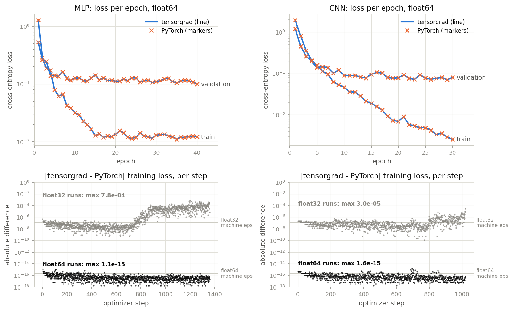
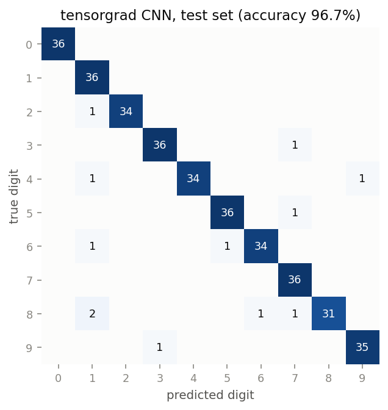
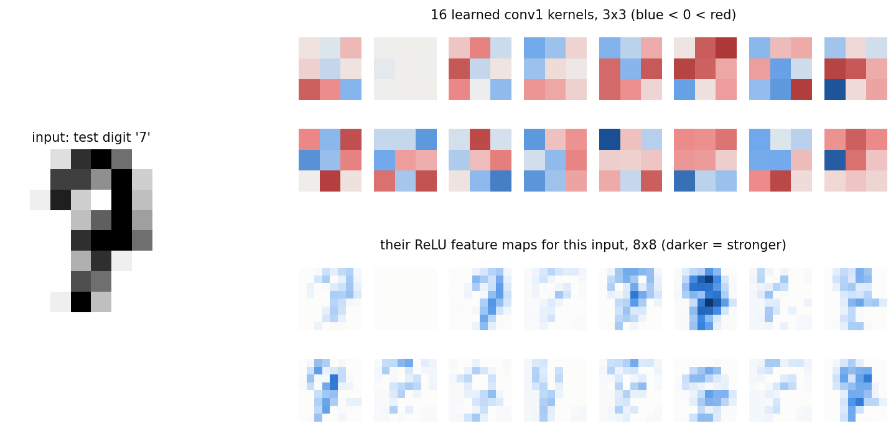

# autograd-from-scratch

A small but real reverse-mode automatic-differentiation engine and neural-network library
(`tensorgrad`) in pure NumPy, verified op by op against PyTorch, that trains an MLP and a CNN.

[](https://github.com/faiqrasulov/autograd-from-scratch/actions/workflows/ci.yml)


## Key results

All numbers come from `make run` and are stored in [`reports/metrics.json`](reports/metrics.json).

- **Op-level correctness.** 37 op cases (every op, plus broadcasting, strided and padded variants) agree with `torch.autograd` to a max gradient difference of **3.6e-15**. They agree with finite differences to a max relative error of **5.4e-7**.
- **Whole training runs match PyTorch to machine precision.** Both frameworks start from the same initial weights, see the same batches and use the same optimizer settings. In float64, the per-step training loss never differs by more than **1.1e-15** (MLP, 1,360 SGD steps) or **1.6e-15** (CNN, 1,020 Adam steps). Final weights differ by at most 1.4e-14, and test predictions are 100% identical.
- **It learns.** Test accuracy on scikit-learn's 8x8 digits (360 held-out images): **CNN 97.9% ± 0.9** and **MLP 97.4% ± 0.2** (mean ± std over 5 seeds). Parameter counts are 13,706 and 17,226.
- **Speed.** Training is CPU-only and single-threaded. On the seed-0 float64 runs, the CNN trains in 1.94 s (PyTorch: 1.23 s) and the MLP in 0.37 s (PyTorch: 0.22 s).
- **Finding along the way:** in float32, PyTorch's NNPACK convolution backend is not exact where the true output is 0. It made the two CNN runs drift apart by up to **2.9e-2** in loss; with NNPACK off the gap is **3.0e-5**. Details are under [Results](#float32-and-the-nnpack-finding).



*Top: per-epoch training and validation loss. The PyTorch markers sit exactly on the tensorgrad
lines. Bottom: absolute per-step loss difference between the two frameworks. In float64 it stays
at the level of float64 machine epsilon for the whole run. In float32, rounding differences slowly
accumulate.*

## Problem & why it matters

Deep-learning frameworks hide most of the mathematics behind `loss.backward()`. That is great
for productivity, but it means bugs and surprises surface far from their cause. Examples: a
gradient silently summed over the wrong axis by broadcasting, an unstable softmax, a
convolution layout mismatch, or an optimizer whose "weight decay" means something different from
what you assumed. Knowing what happens under the hood makes debugging and performance work
much faster.

This project rebuilds the core of such a framework from first principles:

- reverse-mode autodiff over a dynamic graph;
- broadcasting-aware gradients;
- convolution as im2col + matrix multiply;
- optimizer state.

It then *verifies* the implementation. Every op is checked against finite
differences and against PyTorch, and two full training runs are reproduced step by step. A
parity harness like this is also how real framework and kernel teams validate new backends,
and here it surfaced a genuine numerical quirk in PyTorch's float32 CPU convolution path.

## Approach

**What is from scratch:** the library core (`tensor.py`, `functional.py`, `nn.py`, `optim.py`)
uses only NumPy. PyTorch is used only as the *reference* in tests and in the parity experiment,
and is an optional `[dev]` dependency that `parity.py` imports lazily.

### How autodiff works here

Every op computes its output with NumPy and registers a *backward closure*. That closure maps
the upstream gradient `dL/d(out)` to one gradient per input, already reduced to the input's
shape:

```python
# src/tensorgrad/tensor.py (simplified)
def __mul__(self, other):
    a, b = self, self._lift(other)
    def backward(g):                       # g = dL/d(a*b)
        return unbroadcast(g * b.data, a.shape), unbroadcast(g * a.data, b.shape)
    return Tensor._make(a.data * b.data, (a, b), backward, "mul")
```

`loss.backward()` runs as follows:

1. It topologically sorts the graph with an iterative DFS, so even a 5,000-op chain cannot hit
   Python's recursion limit.
2. It walks the graph in reverse, calling each closure.
3. It sums gradients where a tensor feeds several ops.
4. It accumulates the result into `.grad` on leaf tensors only, as PyTorch does; intermediate
   gradients are freed as soon as they have been used.

```python
from tensorgrad import Tensor

x = Tensor([[1.0, 2.0], [3.0, 4.0]], requires_grad=True)
b = Tensor([10.0, -1.0], requires_grad=True)   # broadcast across the rows of x
y = ((x * b).relu() + x).sum()
y.backward()
x.grad   # [[11., 1.], [11., 1.]]   relu'(x*b) * b + 1
b.grad   # [4., 0.]                 summed over the broadcast (row) axis
```

The layer and optimizer API mirrors PyTorch:
`model = nn.Sequential(nn.Linear(64, 32), nn.ReLU(), nn.Linear(32, 10))`, then
`loss = F.cross_entropy(model(x), y)`, then `opt.zero_grad(); loss.backward(); opt.step()`.

### Design decisions

| Decision | Why |
|---|---|
| Backward closures *return* parent gradients; the engine accumulates them | Ops stay pure functions. The engine is the one place that handles fan-out (summing) and frees intermediate gradients. |
| One `unbroadcast(grad, shape)` helper, the adjoint of broadcasting | Every binary op gets broadcasting gradients right in the same way. It sums over added leading axes and over axes that had size 1. |
| Fused `log_softmax` and `cross_entropy` primitives | The log-sum-exp trick makes them stable for logits of ±1000 (tested), and the gradient is simply `softmax - one_hot`. |
| `conv2d` = im2col + one GEMM; `col2im` as its exact adjoint | The loops run over the k×k kernel offsets only, never over pixels. `col2im` is verified with a dot-product test, ⟨im2col(x), y⟩ = ⟨x, col2im(y)⟩. Max-pool reuses the same unfold. |
| Max-pool sends a tied gradient to the first element of the window | This matches PyTorch's CPU kernel. It matters because after ReLU many windows are all zeros (covered by a test). |
| Skip gradient work for inputs that don't need it | For example, the image batch never needs a gradient, so the first conv layer's `col2im` is skipped. |
| Optimizers transcribe `torch.optim` exactly | The first momentum buffer equals the gradient. Adam adds `eps` after the bias-corrected square root, and weight decay is L2 (not AdamW). This is what makes step-by-step trajectories comparable. |
| Parameter names and layouts match `torch.nn` | `Linear.weight` is (out, in) and `Sequential` children are named "0", "1", …. So `parity.to_torch(model)` builds the identical PyTorch model and copies the `state_dict` 1:1. |
| One registry of op cases (`parity.OP_CASES`) | The pytest suite and the report in `make run` check exactly the same cases. |

**Experiment protocol.** The data is the scikit-learn `load_digits` set (1,797 grayscale 8×8
images, no download), with pixels scaled to [0, 1].

- **Split:** stratified 60/20/20, giving 1,077 train, 360 validation and 360 test images.
- **Models:** an MLP, 64→128→64→10 with ReLU, trained with SGD (lr 0.05, momentum 0.9, weight
  decay 1e-3) for 40 epochs. A CNN with two blocks of [conv 3×3 → ReLU → max-pool 2×2] (16 then
  32 channels), followed by 128→64→10 dense layers, trained with Adam (lr 2e-3, weight decay
  1e-4) for 30 epochs. Both use batch size 32.
- **Hyperparameters** are fixed in `cli.py` and are not tuned by `make run`; the search that
  produced them is not recorded in this repo.
- **Parity:** each configuration is trained twice, once by tensorgrad and once by PyTorch. Both
  runs start from the same Kaiming-initialized weights and use a shared, pre-computed batch
  schedule. Both run in float64 and in float32.
- **Threading:** BLAS and PyTorch are pinned to one thread. This makes the runs reproducible and
  fair, and on these tiny matrices it is also faster (see below).

## Results

### Training: tensorgrad vs PyTorch (seed 0, float64)

| Model | Params | Steps | Test acc (tensorgrad) | Test acc (PyTorch) | Max \|Δ loss\| per step | Max \|Δ weight\| at end | Same test predictions | Train time (tensorgrad / PyTorch) |
|---|---:|---:|---:|---:|---:|---:|---:|---:|
| MLP | 17,226 | 1,360 | 97.50% | 97.50% | 1.1e-15 | 1.1e-15 | 100% | 0.37 s / 0.22 s |
| CNN | 13,706 | 1,020 | 96.67% | 96.67% | 1.6e-15 | 1.4e-14 | 100% | 1.94 s / 1.23 s |

**Accuracy across seeds.** Each seed changes both the initialization and the batch order. Results
are for tensorgrad in float64:

| Model | Seeds 0-4 | Mean ± std |
|---|---|---:|
| MLP | 97.50, 97.50, 97.22, 97.22, 97.78 % | 97.44% ± 0.23 |
| CNN | 96.67, 98.33, 97.50, 98.33, 98.89 % | 97.94% ± 0.87 |

<p float="left">
  
  
</p>

*Left: the confusion matrix of the seed-0 CNN on the 360 test images. Its 12 errors are spread
thinly, with 8→1 the only pair occurring twice. Right: the 16 learned 3×3 first-layer kernels and
their ReLU feature maps for a test "7". One kernel has stayed close to zero and produces a blank
map.*

### Op-by-op checks

The summary over all 37 cases:

- max |forward difference| vs PyTorch: 3.6e-15;
- max |gradient difference| vs PyTorch: 3.6e-15;
- max relative error vs central finite differences: 5.4e-7.

The largest values in all three come from the convolution cases, which sum over many terms.

<details>
<summary>Full table (float64, same inputs and same random upstream gradient in both frameworks)</summary>

| Op case | Max \|Δ forward\| vs torch | Max \|Δ grad\| vs torch | Max rel. err vs finite diff. |
|---|---:|---:|---:|
| add | 0.0e+00 | 0.0e+00 | 3.2e-09 |
| add (broadcast 2x3x4 + 4) | 0.0e+00 | 4.4e-16 | 3.2e-09 |
| sub (broadcast 3x1 - 1x4) | 0.0e+00 | 0.0e+00 | 1.7e-10 |
| neg | 0.0e+00 | 0.0e+00 | 2.2e-09 |
| mul (broadcast 2x3x4 * 3x1) | 0.0e+00 | 2.2e-16 | 1.3e-09 |
| div (broadcast 3x4 / 4) | 0.0e+00 | 2.2e-16 | 1.7e-09 |
| scalar ops (2*x - x/3 + 1, 1/x) | 0.0e+00 | 4.4e-16 | 2.3e-09 |
| pow (x**2) | 0.0e+00 | 0.0e+00 | 1.1e-09 |
| pow (x**-1.5) | 0.0e+00 | 8.9e-16 | 6.4e-10 |
| matmul (2-D) | 1.1e-16 | 2.2e-16 | 4.6e-09 |
| matmul (batched, broadcast) | 0.0e+00 | 4.4e-16 | 1.5e-08 |
| matmul (vector @ matrix) | 0.0e+00 | 1.1e-16 | 1.3e-09 |
| exp | 0.0e+00 | 0.0e+00 | 6.1e-09 |
| log | 0.0e+00 | 0.0e+00 | 3.2e-10 |
| sum (all) | 1.1e-16 | 0.0e+00 | 6.4e-11 |
| sum (axis=(0, 2)) | 4.4e-16 | 0.0e+00 | 5.0e-10 |
| sum (axis=1, keepdims) | 0.0e+00 | 0.0e+00 | 3.4e-10 |
| mean (all) | 6.9e-18 | 0.0e+00 | 7.4e-11 |
| mean (axis=-1) | 1.1e-16 | 0.0e+00 | 1.0e-09 |
| max (all) | 0.0e+00 | 0.0e+00 | 4.7e-11 |
| max (axis=1) | 0.0e+00 | 0.0e+00 | 9.2e-10 |
| max (axis=0, keepdims) | 0.0e+00 | 0.0e+00 | 1.0e-10 |
| reshape | 0.0e+00 | 0.0e+00 | 1.8e-08 |
| transpose (permute 2,0,1) | 0.0e+00 | 0.0e+00 | 7.4e-10 |
| getitem (slices + None) | 0.0e+00 | 0.0e+00 | 5.5e-10 |
| getitem (negative step, int) | 0.0e+00 | 0.0e+00 | 1.3e-10 |
| relu | 0.0e+00 | 0.0e+00 | 1.6e-10 |
| tanh | 5.6e-17 | 5.6e-17 | 2.4e-09 |
| sigmoid | 2.2e-16 | 5.6e-17 | 2.0e-08 |
| log_softmax (axis=-1) | 4.4e-16 | 1.1e-16 | 7.0e-09 |
| log_softmax (axis=0) | 4.4e-16 | 1.1e-16 | 2.0e-09 |
| cross_entropy (mean) | 0.0e+00 | 3.5e-18 | 3.2e-09 |
| cross_entropy (sum) | 0.0e+00 | 1.4e-17 | 1.3e-09 |
| conv2d (stride 1, pad 1, bias) | 3.6e-15 | 3.6e-15 | 5.4e-07 |
| conv2d (stride 2, no pad, no bias) | 1.8e-15 | 2.0e-15 | 2.3e-08 |
| max_pool2d (2x2, stride 2) | 0.0e+00 | 0.0e+00 | 3.2e-09 |
| max_pool2d (3x3, stride 1, overlapping) | 0.0e+00 | 2.2e-16 | 3.9e-10 |

The test suite additionally checks Linear, Conv2d and MaxPool2d layers (forward, input gradient
and weight gradients) and a full CNN against PyTorch. It also checks SGD (plain, momentum,
Nesterov, weight decay) and Adam (with and without weight decay) step by step against
`torch.optim`. Independent references include a naive 6-loop convolution and the im2col adjoint
test.
</details>

### Float32 and the NNPACK finding

In float32 the two frameworks cannot match bit for bit, because BLAS libraries sum in different
orders. The per-step loss difference starts around 1e-7, the scale of float32 machine epsilon,
and accumulates over training:

| Float32 run | Max \|Δ loss\| per step | Max \|Δ weight\| at end | Same test predictions |
|---|---:|---:|---:|
| MLP (SGD + momentum) | 7.8e-4 | 3.7e-3 | 100% |
| CNN (Adam), PyTorch NNPACK **off** | 3.0e-5 | 9.3e-4 | 100% |
| CNN (Adam), PyTorch NNPACK **on** (the default) | 2.9e-2 | 2.6e-1 | 100% |

**What did not work at first.** With PyTorch's defaults, the float32 CNN runs drifted apart by
8.3e-4 in loss after a *single* step. That is far too much for rounding. Comparing first-batch
gradients against a float64 reference, on which both frameworks agree to 1e-15, showed:

- tensorgrad's float32 gradients were within 1.3e-7 of the reference;
- PyTorch's float32 gradients were off by up to 4.6e-2;
- yet an isolated PyTorch conv layer fed random upstream gradients was accurate.

The cause was upstream. In the PyTorch build measured here (2.10 on macOS arm64), float32 CPU
convolutions with batch ≥ 16 and autograd enabled are dispatched to **NNPACK**, a
fast-convolution library. NNPACK is accurate to roughly 1e-5, but it does not
reproduce exact zeros. Blank image borders convolved with the zero-initialized bias should give
exactly 0, and ReLU's gradient at 0 is 0.

On 32 training images, 3,696 of the 4,944 exact-zero conv1 outputs came back non-zero, and 1,824
of those came back positive. The max output error was 8.1e-6. So ReLU let gradient through pixels
where mathematically it should not.

With NNPACK disabled, PyTorch's conv output is bit-identical to tensorgrad's (difference 0.0),
and its first-batch gradient error drops to 1.3e-7, the same as tensorgrad's. The parity runs
therefore disable NNPACK, and `make run` re-measures the NNPACK-on run as an ablation.
None of this changes the final accuracy here (all runs make identical test predictions). It is
still the kind of silent backend difference a parity harness exists to catch.

### Speed and threading

tensorgrad is slower than PyTorch: about 1.6x on the CNN and 1.7x on the MLP in the runs above.
Its im2col materializes a (N·OH·OW) × (C·k·k) matrix and every op pays Python overhead. That gap
is small here only because the models are tiny.

A second surprise came from BLAS threading. With NumPy's default 8-thread OpenBLAS pool, 5 epochs
of CNN training took **0.79 s**; with one thread they took **0.42 s**. The matrices are too small
to amortize thread synchronization. This ratio depends heavily on machine load: it was larger in
some development runs on this shared laptop, so treat the timings as indicative. `make run` took
23.7 s and peaked at 284 MB of RAM on an Apple-silicon laptop (8 GB).

### Interpretation

- **Correctness:** the engine is correct to floating-point precision for every implemented op,
  and over entire training runs, not just single steps. Matching at 1e-15 over 1,000+ optimizer
  steps also validates the optimizer state handling, the batch plumbing, and the eval-mode logic.
- **Accuracy:** on 8×8 digits the CNN's advantage is small and seed-dependent. Its mean is 0.5
  points higher, but its seed-0 run (96.7%) is below the MLP's (97.5%). With 8×8 inputs there is
  little spatial structure for convolutions to exploit, and one test image is worth 0.28
  points. The project's claim is correctness, not state-of-the-art accuracy.

## Quickstart

```bash
git clone https://github.com/faiqrasulov/autograd-from-scratch.git
cd autograd-from-scratch
pip install torch --index-url https://download.pytorch.org/whl/cpu   # optional: small CPU-only wheel
make install   # pip install -e ".[dev]"  (numpy, scikit-learn, matplotlib; torch/pytest/ruff for dev)
make run       # ~25 s: op checks, MLP + CNN in both frameworks, metrics.json + figures
make test      # 149 tests, ~4 s
make lint
```

`make install` takes the newest compatible packages. To reproduce the committed `reports/`, use
`make install-locked` instead: it installs the versions pinned in
[`requirements.lock`](requirements.lock) (Python 3.12). With them `make run` gives the same accuracies
and the same parity conclusions. Losses agree with the committed ones to 1e-6 or better; the exact
size of the float64 parity gaps (still at the 1e-15 level) and the timings vary with the
linear-algebra build, and the committed run used Anaconda's numpy build, not the PyPI wheel
(checked on macOS arm64).

`make data` prints the split sizes. The digits dataset ships inside scikit-learn, so nothing is
downloaded.

## Project structure

```
src/tensorgrad/
  tensor.py      Tensor, autodiff engine (topological sort, accumulation), unbroadcast, core ops
  functional.py  log_softmax, cross_entropy, im2col/col2im, conv2d, max_pool2d, dropout
  nn.py          Module/Parameter registry, Linear, Conv2d, MaxPool2d, Flatten, Dropout, Sequential
  optim.py       SGD (momentum, Nesterov, weight decay), Adam (bias-corrected)
  gradcheck.py   finite-difference gradient checker
  parity.py      OP_CASES registry, op-vs-torch comparison, to_torch() model mirror
  data.py        load_digits split + shared batch schedule
  models.py      the MLP and CNN
  train.py       mirrored tensorgrad / PyTorch training loops, parity statistics
  plots.py       report figures
  cli.py         `make run`: reproduces reports/metrics.json and reports/figures/
tests/           engine, gradcheck, torch parity, nn, optim, functional, pipeline smoke tests
reports/         metrics.json + figures (committed)
```

## Limitations & next steps

- **CPU and NumPy only.** There is no GPU support, no kernel fusion and no graph compilation, and
  it is slower than PyTorch even on tiny models. im2col trades memory (a k²-times larger buffer)
  for one large GEMM.
- **Missing features:**
  - higher-order gradients (backward is not itself differentiable);
  - in-place ops; `concat`/`stack`, `min`, `abs`, `sqrt` (use `** 0.5`);
  - tensor-valued exponents;
  - normalization layers (BatchNorm/LayerNorm), average pooling, padded max-pooling, and dilated
    or grouped convolutions;
  - recurrent and attention layers;
  - integer and boolean tensors.
- **Semantics to know:**
  - `Tensor.max` splits the gradient evenly between tied elements, like `torch.amax`, while
    max-pooling sends it to the first tied element, like PyTorch's pooling kernel.
  - Advanced (integer-array) indexing works but uses the slow `np.add.at` scatter.
- **Dropout is implemented and tested, but not in the parity models.** Its random masks come from
  NumPy's generator and cannot match PyTorch's.
- **Scope of the results:** accuracy numbers come from a small, easy dataset with a 360-image test
  set. Timings come from a shared laptop.
- **Next:** a higher-order-capable backward (graph-building backward closures), BatchNorm with
  running statistics, a 28×28 MNIST run where convolution should matter, and a memory profile of
  im2col vs a direct convolution.

## Data & references

- **Data:** E. Alpaydin and C. Kaynak, *Optical Recognition of Handwritten Digits*, UCI Machine
  Learning Repository (1998), https://doi.org/10.24432/C50P49, licensed CC BY 4.0. scikit-learn's
  `load_digits` bundles a copy of its test portion (1,797 images).
- A. G. Baydin, B. A. Pearlmutter, A. A. Radul, J. M. Siskind, *Automatic Differentiation in
  Machine Learning: a Survey*, JMLR 18(153), 2018.
- K. He, X. Zhang, S. Ren, J. Sun, *Delving Deep into Rectifiers* (Kaiming initialization), ICCV
  2015.
- D. P. Kingma, J. Ba, *Adam: A Method for Stochastic Optimization*, ICLR 2015.
- K. Chellapilla, S. Puri, P. Simard, *High Performance Convolutional Neural Networks for Document
  Processing* (unfolding convolution into a matrix multiply), IWFHR 2006.
- A. Paszke et al., *PyTorch: An Imperative Style, High-Performance Deep Learning Library*,
  NeurIPS 2019. M. Dukhan, *NNPACK*, https://github.com/Maratyszcza/NNPACK.
- The scalar-valued engine in A. Karpathy's *micrograd* is the classic minimal version of this
  idea. tensorgrad extends it to tensors, broadcasting, convolution and optimizer state.

## License

MIT. See [LICENSE](LICENSE).
